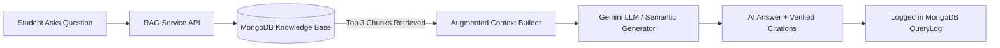

# 🎓 AI Campus Companion - RAG & MongoDB Setup Guide

This guide walks you through the **Retrieval-Augmented Generation (RAG)** system implemented with **MongoDB** for your **Campus Companion** project.

---

## 🏗️ Architecture: How RAG Works in this Project



1. **Knowledge Ingestion (`seed.js`)**:
   - Academic PDFs/handbooks are broken into logical **sections/chunks**.
   - Each chunk receives keywords, metadata (course, page, filename), and a **128-dimensional semantic embedding**.
   - Chunks are stored in the MongoDB `documents` collection.

2. **Retrieval (`services/embeddingService.js`)**:
   - When a student asks a question, the system converts the query into a semantic vector.
   - Calculates **Cosine Similarity** + **Keyword Boosting** across all document chunks in MongoDB.
   - Retrieves the top 3 most relevant document sections.

3. **Augmentation & Generation (`services/ragService.js`)**:
   - The retrieved text is injected into an augmented prompt: *"Based ONLY on these verified campus documents..."*
   - Generated by **Google Gemini API** (or the smart local fallback generator if no API key is provided).

4. **Analytics (`models/QueryLog.js`)**:
   - Every question and response time is logged in MongoDB to power the **Faculty Analytics (`analytics.html`)** dashboard!

---

## 📚 The 3 Dummy Documents Seeded in MongoDB

| # | Document Title | Course / Dept | Key Topics / Chunks Included |
|---|---|---|---|
| **1** | **CS101 Syllabus & Course Policies** (`CS101_Syllabus_Fall2026.pdf`) | CS101 | • Instructor Dr. Sharma Office Hours (Mon & Thu 2-4 PM in Room 402)<br>• Grade Breakdown (30% Assignments, 25% Midterm, 25% Capstone, 20% Quizzes)<br>• Late Submission Policy (10% per 24h, 0 after 72h, MOSS plagiarism checks) |
| **2** | **Campus Library and Computing Facilities** (`Campus_Library_and_Lab_Regulations_2026.pdf`) | Campus IT | • Library Timings (Weekdays: 8 AM - 10 PM, Weekends: 10 AM - 6 PM, 24/7 during Exam Weeks)<br>• Book Borrowing Quotas (5 books for 14 days, ₹10/day fine)<br>• Computer Lab GPU Workstations & 200 free print quota |
| **3** | **Academic Calendar & Exam Schedule** (`Academic_Calendar_Fall2026.pdf`) | Registrar | • Semester Dates (Classes start Aug 18, Add/Drop deadline Sept 2)<br>• Exam Dates (Midterms Oct 12-20, CS101 Final Exam: Dec 10 in Hall A)<br>• Make-up Exam rules & 48h medical certificate protocol |

---

## 🚀 Step-by-Step Setup Instructions

### Step 1: Install Dependencies
Open your terminal in the `campus_campanion` directory:
```bash
npm install
```

### Step 2: Ensure MongoDB is Running
- **Local MongoDB**: Ensure your local MongoDB service is running on the default port `27017` (e.g., through MongoDB Compass or running `mongod`).
- **MongoDB Atlas (Cloud)**: If using Atlas, copy your connection string and paste it into `.env`:
  ```env
  MONGODB_URI=mongodb+srv://<username>:<password>@cluster0.mongodb.net/campus_companion
  ```

### Step 3: Seed the 3 Dummy Entries into MongoDB
Run the database seed script:
```bash
npm run seed
```
You will see output confirming:
```
✓ Successfully connected to MongoDB!
  ✓ Inserted Document: "CS101 - Introduction to Computer Science Syllabus & Course Policies" (3 chunks)
  ✓ Inserted Document: "Campus Library and Computing Facilities Regulations" (3 chunks)
  ✓ Inserted Document: "Academic Calendar & Examination Schedule (Fall Semester 2026)" (3 chunks)
🎉 Seed Completed! Total Documents in Knowledge Base: 3
```

### Step 4: Verify via CLI Test (Optional)
Test the RAG retrieval directly in your terminal:
```bash
npm run test:rag
```
This runs 3 automated queries through the RAG pipeline and prints the retrieved MongoDB citations and answers.

### Step 5: Start the Web Application
```bash
npm start
```
Then open in your browser:
- **AI Chat (RAG)**: [http://localhost:5000/chat.html](http://localhost:5000/chat.html)
- **Student Dashboard**: [http://localhost:5000/dashboard.html](http://localhost:5000/dashboard.html)
- **Faculty Analytics**: [http://localhost:5000/analytics.html](http://localhost:5000/analytics.html)

---

## 💡 Example Questions to Try in the Chat

1. *"What is the late penalty for CS101 programming assignments?"*
   - **Retrieved Chunk**: `CS101 Syllabus -> Late Submission Policy`
   - **Answer**: 10% penalty per 24 hours up to 72 hours, 0 after 72 hours.
2. *"When is the CS101 final exam and where is it located?"*
   - **Retrieved Chunk**: `Academic Calendar -> Examination Schedule`
   - **Answer**: Thursday, December 10, 2026, from 9:00 AM to 12:00 PM in Examination Hall A.
3. *"Is the library open on weekends or during exam periods?"*
   - **Retrieved Chunk**: `Library Regulations -> Library Hours`
   - **Answer**: 10:00 AM to 6:00 PM on weekends, and open 24/7 during midterm and final exam weeks.

---

## 🔑 (Optional) Enable Google Gemini LLM
In `.env`:
```env
GEMINI_API_KEY=your_gemini_api_key_here
```
When provided, the backend automatically uses Gemini 1.5 Flash to synthesize answers with conversational warmth. When omitted, the built-in deterministic local generator provides instant, verified answers offline!
