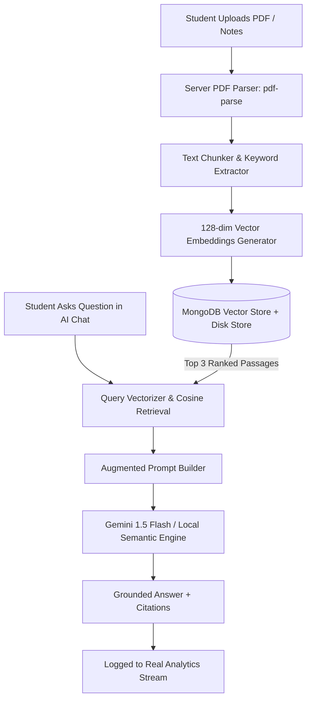

# 🎓 AI Campus Companion (RAG & MongoDB)

> A modern, full-stack academic assistant built with **React 19**, **MongoDB Vector Search**, and **Retrieval-Augmented Generation (RAG)**. It delivers accurate, course-specific answers, smart timetable management, PDF-based knowledge retrieval, and real-time faculty insights.

---

## 🌟 Key Features

### 1. 🤖 Syllabus-Grounded RAG AI Chat (`/chat`)
- **Semantic Retrieval**: Queries are converted into 128-dimensional dense vectors and matched against document passages using **Cosine Similarity** + **Keyword Boosting**.
- **Verified Source Citations**: Every response cites the exact document title, section heading, and similarity score.
- **Hybrid AI Generation**: Powered by **Google Gemini 1.5 Flash** with an intelligent offline deterministic fallback generator when running without an API key.

### 2. 📄 Knowledge Base Document Ingestion (`/documents`)
- **PDF Text Extraction**: Built-in server extraction endpoint using `pdf-parse` extracts clean, human-readable text from uploaded PDFs—preventing raw binary bytecode dumps.
- **Intelligent Chunking**: Automatic sectioning, heading detection, and keyword extraction.
- **Offline Persistence**: All indexed documents and vector embeddings are stored in MongoDB and backed up to disk (`data/knowledge_base_store.json`), ensuring newly uploaded documents persist across user logouts, page reloads, and server restarts.

### 3. 📅 Interactive Student Dashboard (`/dashboard`)
- **Semester 5 Class & Lab Timetable**: Live schedule tracking for lectures (Rooms 402, 201, 303B) and laboratory sessions (Labs 4B, 3A, 5C, 2C).
- **Upcoming Assignments & Deadlines**: Real assignment tracking for WAD, ML, DCN, SS, and DMBI.
- **Dynamic Knowledge Base Stats**: Instant overview of indexed documents and active RAG status.

### 4. 📊 Faculty & Administrator Analytics (`/analytics`)
- **Passcode Protected Gate**: Secure faculty login (Admin Passcode: `1234`).
- **Real Student Struggle Topics**: Auto-clusters questions into topics with High/Medium/Low priority badges.
- **Course Volume Telemetry**: Visual breakdown of query volume across academic courses.
- **Live Queries Feed**: Dedicated scrollable feed with response latency, course tags, and resolution status.

### 5. 🔐 User Authentication
- Fast client-side session management with login, registration, and persistent user profile tracking.

---

## 🏗️ Architecture



---

## 🛠️ Tech Stack

| Layer | Technology |
|---|---|
| **Frontend** | React 19, Vite 8, React Router 7, Lucide Icons |
| **Backend** | Node.js, Express.js |
| **Database** | MongoDB with Mongoose (with offline JSON persistence) |
| **PDF Extraction** | `pdf-parse` |
| **Embeddings & Search** | Local dense semantic vectorizer + Cosine similarity + Keyword boost |
| **AI LLM** | Google Gemini API (`@google/generative-ai`) / Local grounded engine |

---

## 🚀 Getting Started

### Prerequisites
- [Node.js](https://nodejs.org/) (v18 or higher recommended)
- [MongoDB](https://www.mongodb.com/) (Optional: the app runs with full in-memory and disk persistence if MongoDB is offline)

### 1. Installation
Clone the repository and install dependencies:
```bash
git clone https://github.com/hitarthpatel2404/campus_campanion.git
cd campus_campanion
npm install
```

### 2. Environment Configuration
Create a `.env` file in the root directory:
```env
PORT=5000
MONGODB_URI=mongodb://127.0.0.1:27017/campus_companion
GEMINI_API_KEY=your_gemini_api_key_here
```
> *Note: If `GEMINI_API_KEY` is omitted, the app will automatically use its built-in local semantic answering engine.*

### 3. Build Frontend & Start Server
```bash
# Build React application with Vite
npm run build

# Start Express backend server
npm start
```

Open your browser at: **[http://localhost:5000](http://localhost:5000)**

---

## 🔑 Credentials & Access

| Portal | URL | Access / Credentials |
|---|---|---|
| **Landing Page** | `http://localhost:5000/` | Public |
| **AI Chat** | `http://localhost:5000/chat` | Authenticated Student / Guest |
| **Dashboard** | `http://localhost:5000/dashboard` | Authenticated Student / Guest |
| **Documents** | `http://localhost:5000/documents` | Upload & Index Knowledge Base |
| **Faculty Analytics** | `http://localhost:5000/analytics` | **Admin Passcode**: `1234` |

---

## 📁 Project Structure

```
├── data/                       # Persistent JSON storage
│   ├── knowledge_base_store.json
│   └── query_logs_store.json
├── models/                     # Mongoose Schemas
│   ├── Document.js             # Document & Chunk Schema with embeddings
│   └── QueryLog.js             # Query Telemetry Schema
├── services/
│   ├── embeddingService.js     # Vectorizer & Cosine Similarity search
│   └── ragService.js           # RAG pipeline, persistence, & real analytics
├── src/
│   ├── assets/                 # Static images & hero graphics
│   ├── context/
│   │   └── AuthContext.jsx     # User authentication state provider
│   ├── data/
│   │   └── scheduleData.js     # Semester 5 timetable & lab schedule
│   ├── pages/
│   │   ├── Home.jsx            # Landing page
│   │   ├── Login.jsx           # Student Login
│   │   ├── Signup.jsx          # Student Registration
│   │   ├── Dashboard.jsx       # Timetable & course insights dashboard
│   │   ├── Chat.jsx            # RAG AI Chat interface
│   │   ├── Documents.jsx       # Knowledge base document upload & index
│   │   └── Analytics.jsx       # Faculty query analytics portal
│   ├── styles/                 # Custom component stylesheets
│   ├── App.jsx                 # Client-side routing & ScrollToTop
│   └── main.jsx                # React root mount
├── seed.js                     # Knowledge base seed script
├── server.js                   # Express backend API & static server
└── package.json
```

---

## 📡 REST API Reference

| Method | Endpoint | Description |
|---|---|---|
| `GET` | `/api/health` | Health check & MongoDB connection status |
| `GET` | `/api/documents` | Retrieve all active knowledge base documents |
| `POST` | `/api/documents/extract` | Extract plain text from PDF or text file payload |
| `POST` | `/api/documents/upload` | Chunk, embed, and index new document |
| `DELETE` | `/api/documents/:id` | Remove document from knowledge base |
| `POST` | `/api/documents/seed` | Reset knowledge base to default course documents |
| `POST` | `/api/rag/chat` | Execute RAG query (retrieval + augmented answer) |
| `GET` | `/api/analytics` | Retrieve real telemetry, struggle topics, & query feed |

---

## 📜 License
This project is open-source under the MIT License.
